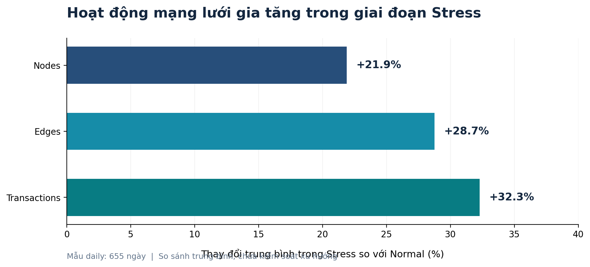
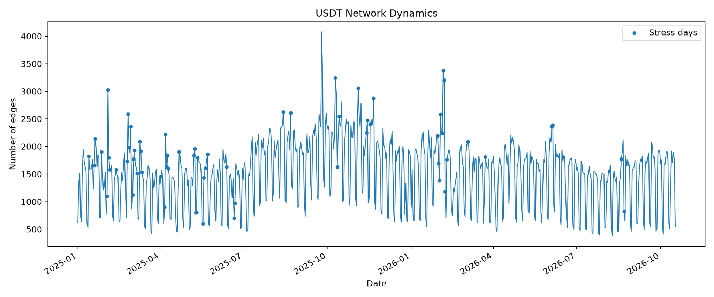
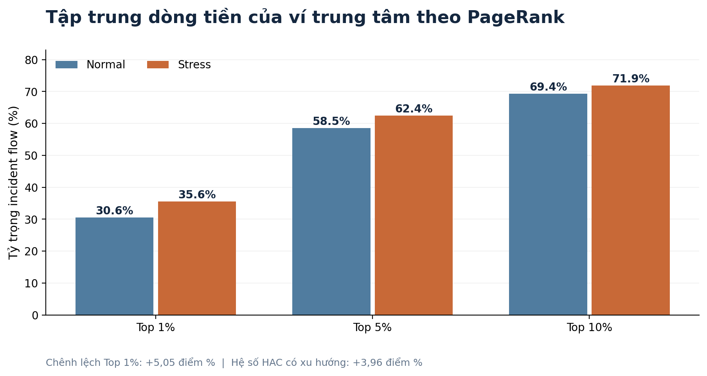
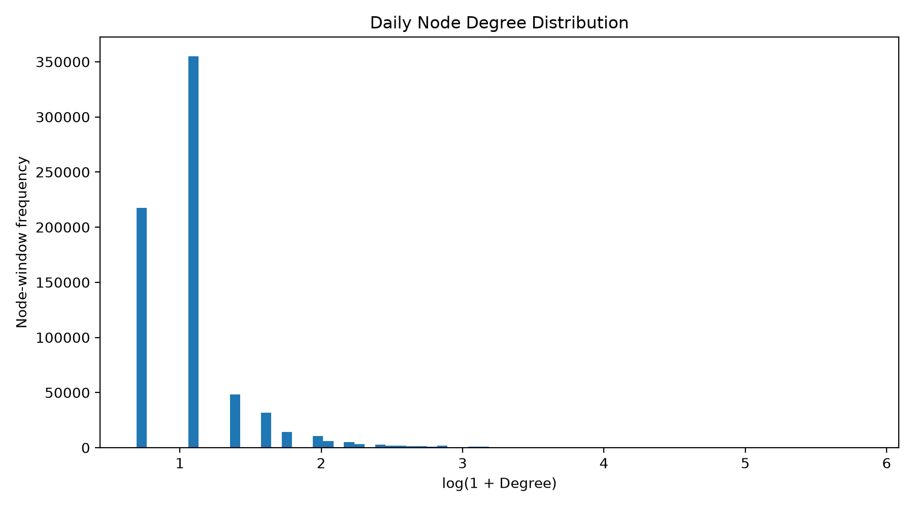

# T13 — Network Statistics & Centrality Analysis

**Dự án:** On-chain Network & Whale Contagion Analysis  
**Thời gian dữ liệu:** 01/01/2025 – 17/10/2026  
**Ngày tổng hợp:** 22/10/2026

> Báo cáo này mô tả các kết quả thống kê đã chạy và các giới hạn diễn giải. Các liên hệ quan sát được không đồng nghĩa với quan hệ nhân quả.

Cấu trúc mạng lưới giao dịch USDT trên Ethereum và sự tập trung dòng tiền của ví trung tâm trong điều kiện thị trường bình thường và căng thẳng

Dự án nhóm: On-chain Network & Whale Contagion Analysis

| Phạm vi | Thông tin |
| --- | --- |
| Thời gian nghiên cứu | 01/01/2025 – 17/10/2026 (655 ngày) |
| Thị trường tham chiếu | ETH/USDT – OHLCV 1 phút |
| Phân tích | RQ1 cấu trúc mạng • RQ2 tập trung ví trung tâm |
| Nguồn dữ liệu | T06 thị trường, T08 đồ thị giao dịch, T09 độ trung tâm |
| Tình trạng | Pipeline chạy hoàn tất; 20 Parquet và 4 hình đã sinh; reader HF main đọc thành công |

## TÓM TẮT ĐIỀU HÀNH

Kết quả T13 cho thấy trạng thái biến động mạnh của ETH/USDT đi kèm sự mở rộng đáng kể của mạng giao dịch USDT trên Ethereum: số ví tăng 21,90%, số cạnh tăng 28,75%, số giao dịch tăng 32,28% và giá trị giao dịch tăng 33,98% so với các ngày bình thường. Tuy nhiên, mật độ mạng giảm 17,79%, phản ánh việc mạng phát triển quy mô nhanh hơn số liên kết so với mức tối đa có thể hình thành.

Về ví trung tâm, nhóm Top 1% xếp theo PageRank chiếm 30,56% incident flow trong trạng thái Normal và 35,61% trong Stress. Chênh lệch mô tả là +5,05 điểm phần trăm; hệ số Stress từ hồi quy có xu hướng thời gian và sai số chuẩn HAC là +3,964 điểm phần trăm (p đã hiệu chỉnh BH-FDR ≈ 0,000978). Sau hiệu chỉnh nhiều kiểm định, 7/11 chỉ số RQ1 và 7/9 tổ hợp RQ2 có ý nghĩa ở mức 5%.

Các kết quả là mối liên hệ thống kê, không chứng minh ví lớn gây ra biến động giá hay hiệu ứng lây lan nhân quả.

## 1. Câu hỏi nghiên cứu và phạm vi

### 1.1. Câu hỏi nghiên cứu

RQ1 – How does network structure change between Normal and Stress periods? So sánh 11 chỉ số cấu trúc và hoạt động mạng lưới USDT giữa hai chế độ thị trường.

RQ2 – Do central wallets play a disproportionate role in transaction flows? Đo tỷ trọng incident flow thuộc Top 1%, 5% và 10% ví được xếp hạng bằng Degree, PageRank và Weighted Degree (USDT).

### 1.2. Nguồn dữ liệu và đơn vị quan sát

| Nguồn | Mục đích | Quy mô |
| --- | --- | --- |
| T06 – ETH/USDT OHLCV 1 phút | RV, downside volatility, selling pressure | 655 ngày × 1.440 phút/ngày |
| T08 – Graph metrics | 11 chỉ số mạng lưới Daily/Weekly | 655 ngày; 94 tuần |
| T09 – Node centrality | Phân phối centrality và Top-K flow share | 712.519 node-day; 388.557 node-week |

Tuần ISO 2025-W01 (5 ngày) và 2026-W42 (6 ngày) được loại khỏi phân tích theo tuần. Mẫu Weekly hợp lệ còn 92 tuần. Dữ liệu T09 được dùng riêng cho các chỉ số ví; không thay bằng dữ liệu T10.

## 2. Phương pháp nghiên cứu

### 2.1. Xác định trạng thái thị trường

Realized Volatility theo ngày được tính bằng căn bậc hai của tổng bình phương lợi suất log phút. Để bảo toàn chuỗi liên tục, lợi suất từ giá đóng cửa cuối ngày trước đến giá đầu ngày sau được thêm vào nếu hai ngày kề nhau. Stress khi RV lớn hơn phân vị P90 của toàn bộ 655 ngày.

| Chỉ tiêu | Kết quả |
| --- | --- |
| RV P90 (ngày) | 4,8695% |
| Normal / Stress | 589 ngày / 66 ngày |
| Tuần hợp lệ | 92 tuần (82 Normal / 10 Stress) |
| RV P90 (tuần) | ≈ 12,3722% |

Độ nhạy được kiểm tra tại P80, P90 và P95; robustness dùng CMSI-3 = [z(RV)+z(DownsideVol)+z(SellingPressure)]/3 và CMSI-2 = [z(RV)+z(SellingPressure)]/2. Các biến chuẩn hóa theo độ lệch chuẩn mẫu (ddof=1).

### 2.2. Tỷ trọng dòng tiền ví trung tâm

Flow Share(Top-K) = tổng Weighted Degree USDT của các ví Top-K / tổng Weighted Degree USDT của tất cả ví trong cùng snapshot. Chỉ tiêu này phản ánh incident flow (cả phía gửi lẫn phía nhận), vì vậy không diễn giải là tỷ lệ số lượng giao dịch hoặc phần dòng tiền độc lập chỉ tính một lần.

### 2.3. Kiểm định thống kê

Với từng chỉ số Y, mô hình hồi quy Yₜ = α + β·Stressₜ + γ·Trendₜ + εₜ. Sai số chuẩn Newey–West HAC với maxlags=7; khoảng tin cậy 95%; hiệu chỉnh đa kiểm định bằng Benjamini–Hochberg (BH-FDR), ngưỡng 5%. Đây là so sánh có kiểm soát xu hướng tuyến tính, không phải xác định quan hệ nhân quả.

## 3. Kết quả RQ1 – Cấu trúc mạng Normal và Stress

| Chỉ số | Thay đổi trung bình Stress so với Normal | BH-FDR < 5% |
| --- | --- | --- |
| Nodes | +21,90% | Có |
| Edges | +28,75% | Có |
| Total volume USDT | +33,98% | Có |
| Transactions | +32,28% | Có |
| Density | −17,79% | Có |
| Reciprocity | −4,48% | Không |
| Weakly connected components | +7,95% | Có |
| Strongly connected components | +17,61% | Có |
| Top-10 volume share | −4,33% | Không |
| Gini volume | +1,32% | Không |
| HHI volume | −8,87% | Không |

*Hình 1. Thay đổi hoạt động mạng giao dịch USDT: Stress so với Normal (thiết kế lại từ số liệu xác nhận).*

Các biến phản ánh quy mô và hoạt động giao dịch tăng cùng chiều với trạng thái Stress, và đa số còn có ý nghĩa sau BH-FDR. Ngược lại, density giảm dù edges tăng: số ví tăng khiến số cạnh tiềm năng tăng nhanh, do đó không nên kết luận mạng kết nối dày đặc hơn chỉ dựa vào số cạnh. Các thước đo tập trung toàn mạng (Top-10 share, Gini, HHI) không đồng loạt tăng hoặc đạt ý nghĩa thống kê.

*Hình 2. Biến động số cạnh theo thời gian; điểm Stress được đánh dấu (hình nguồn tái lập từ pipeline).*

Biểu đồ thời gian minh họa việc nhiều phiên Stress đi kèm các đợt mở rộng số cạnh. Tuy nhiên, trạng thái Stress được xác định bởi biến động ETH/USDT, không phải bởi số cạnh; không diễn giải đường biểu đồ như quan hệ nhân quả.

## 4. Kết quả RQ2 – Tập trung dòng tiền ví trung tâm

| Ranking | Top-K | Normal (%) | Stress (%) | Chênh lệch (điểm %) |
| --- | --- | --- | --- | --- |
| Degree | 1% | 23,98 | 27,46 | +3,49 |
| Degree | 5% | 46,92 | 50,72 | +3,80 |
| Degree | 10% | 58,31 | 61,42 | +3,11 |
| PageRank | 1% | 30,56 | 35,61 | +5,05 |
| PageRank | 5% | 58,53 | 62,43 | +3,90 |
| PageRank | 10% | 69,35 | 71,94 | +2,58 |
| Weighted Degree | 1% | 37,12 | 39,76 | +2,65 |
| Weighted Degree | 5% | 66,16 | 67,88 | +1,72 |
| Weighted Degree | 10% | 77,12 | 78,20 | +1,08 |

*Hình 3. Tỷ trọng incident flow của nhóm ví Top-K theo PageRank (thiết kế lại từ số liệu xác nhận).*

PageRank Top 1% tăng từ 30,5631% lên 35,6130% (+5,0499 điểm phần trăm). Sau kiểm soát trend, hệ số Stress = +3,9640 điểm phần trăm; HAC SE = 1,0242; p-value = 0,000109; BH-adjusted p-value = 0,000978; khoảng tin cậy 95% [1,9566; 5,9714]. Tỷ trọng mô tả và hệ số hồi quy không đồng nhất về cách tính.

| Tổ hợp kiểm định RQ2 | Hệ số Stress (điểm %) | BH p-value | Ý nghĩa 5% |
| --- | --- | --- | --- |
| Degree Top 1% | +2,559 | 0,001078 | Có |
| Degree Top 5% | +2,194 | 0,017938 | Có |
| Degree Top 10% | +1,522 | 0,032029 | Có |
| PageRank Top 1% | +3,964 | 0,000978 | Có |
| PageRank Top 5% | +2,924 | 0,012813 | Có |
| PageRank Top 10% | +1,928 | 0,032029 | Có |
| Weighted Degree Top 1% | +2,645 | 0,019013 | Có |
| Weighted Degree Top 5% | +1,262 | 0,184715 | Không |
| Weighted Degree Top 10% | +0,740 | 0,307619 | Không |

*Hình 4. Histogram của log(1 + degree) trên các quan sát ví–ngày (hình nguồn tái lập từ pipeline).*

Đồ thị cho thấy phân phối degree bất đối xứng: phần lớn quan sát tập trung ở số liên kết thấp, bên cạnh một phần đuôi các ví có kết nối cao. Hình mô tả phân phối degree, không tự thân cho biết thay đổi phân phối theo Stress; bằng chứng khác biệt theo chế độ nằm ở các bảng Top-K và kiểm định.

## 5. Kiểm tra theo tuần và độ bền kết quả

### 5.1. Weekly comparison

Từ 94 nhãn tuần ISO, loại hai tuần không đầy đủ, còn 92 tuần hợp lệ (82 Normal, 10 Stress). Trên mẫu tuần, số ví tăng khoảng 16,03%; số cạnh +20,07%; volume +26,32%; transactions +22,84% trong Stress. PageRank Top 1% có flow share Normal 52,68% và Stress 56,83%. Kết quả chỉ mang tính so sánh trung bình theo tuần, không tương đương hệ số HAC theo ngày.

### 5.2. Sensitivity và CMSI

| Định nghĩa Stress | Hệ số Stress: PageRank Top 1% (điểm %) |
| --- | --- |
| Daily RV P80 | +5,21176 |
| Daily RV P90 (cơ sở) | +3,96402 |
| Daily RV P95 | +4,05161 |
| CMSI-3 | +4,59664 |
| CMSI-2 | +3,57981 |

Chiều dương của hệ số PageRank Top 1% duy trì khi đổi ngưỡng RV và chỉ số Stress tổng hợp; đây là tín hiệu về tính nhất quán dấu của kết quả. Chưa suy ra tất cả các kiểm định đều có ý nghĩa nếu không đối chiếu riêng p-value của từng bảng robustness.

## 6. Diễn giải, hạn chế và hàm ý

Khi mức biến động thị trường tăng, mạng chuyển USDT có xu hướng gia tăng số lượng chủ thể và cạnh giao dịch, đồng thời hoạt động của nhóm ví trung tâm theo PageRank chiếm tỷ trọng incident flow lớn hơn. Tuy vậy, sự giảm mật độ và những kết quả không có ý nghĩa đối với HHI, Gini hoặc Top-10 volume share cho thấy “mạng giao dịch sôi động hơn” không đồng nghĩa “mọi thước đo tập trung đều tăng”.

Các hạn chế chính gồm: (i) Stress đo bằng ETH/USDT RV, là biến đại diện thị trường chứ không phải biến cố độc lập của mạng USDT; (ii) địa chỉ on-chain không luôn đại diện cho một tác nhân kinh tế duy nhất; (iii) incident flow ghi nhận ở cả hai đầu giao dịch, không phản ánh dòng tiền ròng của ví; (iv) mức độ tập trung chưa chứng minh cơ chế contagion hay quan hệ nguyên nhân–kết quả; (v) mô hình trend tuyến tính/HAC xử lý một phần lệ thuộc thời gian nhưng không loại bỏ toàn bộ yếu tố gây nhiễu.

Ở nghiên cứu nhóm tiếp theo, có thể dùng chỉ báo ví lớn/whale classification, thiết kế event study hoặc mạng theo chiều thời gian, đồng thời kiểm soát thanh khoản, hoạt động sàn và yếu tố vĩ mô nếu dữ liệu cho phép.

## 7. Sản phẩm bàn giao và khả năng tái lập

| Đầu ra | Tình trạng đã xác nhận |
| --- | --- |
| T13_Network_Statistics.py | Pipeline đã chạy hoàn tất trong Worktree; 20 CSV + 20 Parquet + 4 PNG |
| T13_Read_Results.py | Đọc thành công 20 Parquet từ Hugging Face main |
| Dataset Hugging Face | 20 Parquet trên main: team-crypto/Market-data-crypto-project/data/processed/t13 |
| GitHub | Commit c5602bf trên nhánh feature/t13-parquet-update đã push; việc merge PR GitHub chưa được xác nhận |
| Đối chiếu giá trị | 20 Parquet khớp CSV của cùng lần chạy; các mốc trọng yếu RV, RQ1, RQ2 khớp kết quả gốc |

Lưu ý nghiệm thu: phép kiểm tra nhất quán CSV ↔ Parquet mới không thay thế kiểm tra từng giá trị của toàn bộ 20 bảng với bản gốc. Những kết luận trên dựa vào kiểm thử pipeline và các bảng trọng yếu đã được đối chiếu trong phiên làm việc.

## Nguồn và tài liệu tham chiếu

[1] Dữ liệu nhóm: https://huggingface.co/datasets/team-crypto/Market-data-crypto-project (T06, T08, T09 và 20 kết quả Parquet T13).

[2] Mã nguồn nhóm: https://github.com/Quangvtpy06/On-chain-Network-Whale-Contagion-Analysis (nhánh feature/t13-parquet-update, commit c5602bf).

[3] Output T13: các bảng network_normal_vs_stress, rq1_network_hac_fdr_results, central_wallet_concentration_comparison, rq2_hac_fdr_results và 4 hình PNG do pipeline tạo; kết quả Terminal người thực hiện cung cấp ngày 22/10/2026.
